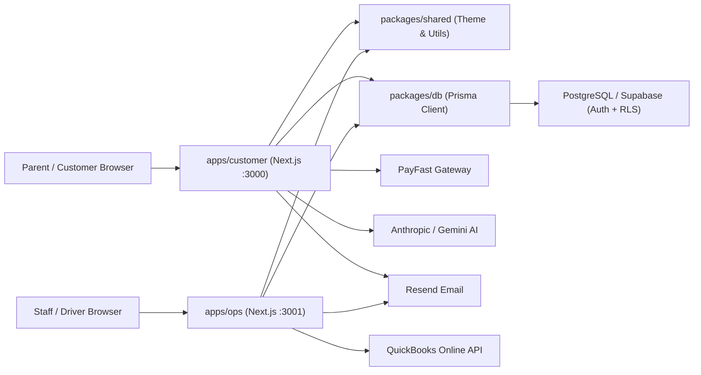

# Prepped 4 Prep

A dual-application back-to-school stationery e-commerce and warehouse operations platform built as a `pnpm` monorepo. Parents can browse school-and-grade stationery lists, upload or paste custom school lists for AI-assisted product matching, and pay online, while warehouse, finance, and admin staff manage fulfillment, barcode-verified packing, deliveries, and accounting sync from a completely isolated internal app.

## Architecture

The codebase separates the public customer storefront (`apps/customer`) from the internal staff portal (`apps/ops`) so customer browsers never load admin or warehouse code. Both applications share a normalized PostgreSQL database via a common Prisma package (`packages/db`) and shared design tokens/utilities (`packages/shared`), with Supabase Auth role claims and Row-Level Security (RLS) enforcing access boundaries.



### Monorepo Layout

```text
├── apps/
│   ├── customer/        # Public customer portal (Next.js App Router, port 3000)
│   └── ops/             # Staff-only operations portal (Next.js App Router, port 3001)
├── packages/
│   ├── db/              # Prisma schema, migrations, seed script, Supabase RLS SQL
│   └── shared/          # Brand theme tokens, shared TypeScript types, shared helpers
├── tests/               # Playwright & Vitest test suites
├── render.yaml          # Dual-service Render deployment configuration
├── .env.customer.example
└── .env.ops.example
```

## Key Features

### Customer Portal (`apps/customer`)
- **School & Grade Template Picker**: Select a school and grade to pre-populate a stationery cart from reusable school list templates.
- **AI Smart List Import**: Upload a PDF/photo or paste raw stationery list text; server-side AI extracts line items, maps them to catalog products, suggests cheaper category alternatives, and recommends add-on services (e.g. book covering, custom labeling) in an editable draft cart.
- **PayFast Checkout & ITN Webhooks**: Online checkout supporting sandbox and live modes with server-verified ITN payment callbacks.
- **Order Tracking & History**: Parents can track fulfillment stages and view order history scoped to their account.
- **POPIA Compliance & Data Protection**: Explicit opt-in consent timestamping, AES-256 column-level encryption for sensitive PII, rate limiting via Upstash Redis, and ephemeral processing of uploaded stationery lists.

### Internal Operations (`apps/ops`)
- **Role-Based Staff Access**: Scoped views and authorization for Admin, Finance, and Warehouse roles.
- **Catalog, Schools & Templates**: Manage products, low-stock reorder thresholds, suppliers, school registries, and per-grade templates (including AI-assisted bulk product import).
- **Warehouse Packing Queue**: Barcode/QR verification workflow (`html5-qrcode` / `qrcode`) and printable box-note workflow.
- **Delivery & Proof of Delivery**: Driver delivery tracking and proof-of-delivery capture.
- **QuickBooks Online Sync**: Automated two-way OAuth2 sync that creates QuickBooks invoices for paid orders and tracks sync status (`pending`, `synced`, `failed`).

## Tech Stack

- **Framework**: Next.js 16 (App Router), React 19, TypeScript
- **Monorepo**: `pnpm` workspaces
- **Styling**: Tailwind CSS v4 with shared brand tokens
- **Database & Auth**: PostgreSQL on Supabase, Prisma 5 ORM, Supabase Auth & RLS
- **Integrations**: PayFast (payments), Anthropic / Gemini (AI list parsing), QuickBooks Online API (accounting sync), Resend (transactional email), Upstash Redis (rate limiting)
- **Testing & Hosting**: Playwright, Vitest, Render (`render.yaml`)

## Screenshots

> Add screenshots of the deployed or local apps below.

| Customer Portal | Internal Ops Dashboard |
| --- | --- |
| *Placeholder: Storefront & Smart List Import* | *Placeholder: Orders, Packing Queue & BI* |

## Local Setup

### Prerequisites
- Node.js `>= 20` (see `render.yaml` / root `package.json`)
- `pnpm`
- A PostgreSQL / Supabase project

### 1. Install Dependencies

```bash
pnpm install
```

### 2. Configure Environment Variables

Copy the example environment files into each app and fill in your credentials:

```bash
cp .env.customer.example apps/customer/.env.local
cp .env.ops.example apps/ops/.env.local
```

> Make sure `ENCRYPTION_SECRET` (32+ characters) matches across both `apps/customer/.env.local` and `apps/ops/.env.local`.

### 3. Prepare the Database

Generate the Prisma client, push the schema, and seed sample data:

```bash
pnpm db:generate
pnpm db:push
pnpm db:seed
```

To apply Supabase Row-Level Security policies, run [packages/db/supabase-rls.sql](packages/db/supabase-rls.sql) against your Supabase Postgres instance.

### 4. Run the Development Servers

Run each app in its own terminal:

```bash
# Customer Portal (http://localhost:3000)
pnpm dev:customer

# Internal Ops Portal (http://localhost:3001)
pnpm dev:ops
```

### 5. Build & Test

```bash
# Build all workspace packages and apps
pnpm build

# Run Vitest unit tests
pnpm test:unit

# Run Playwright end-to-end tests
pnpm test
```
