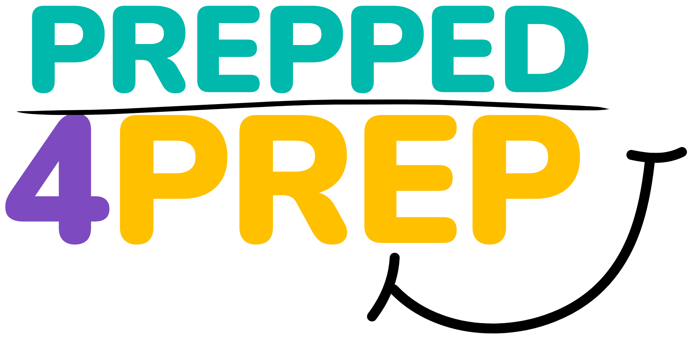
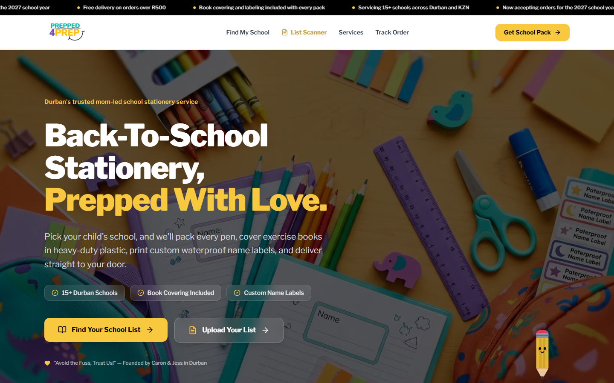
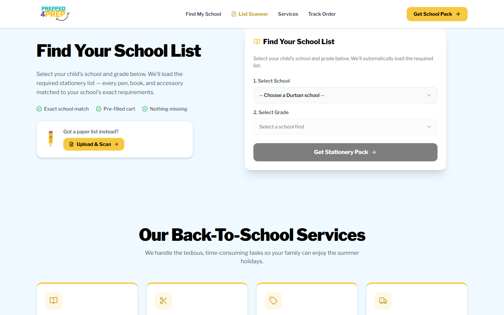
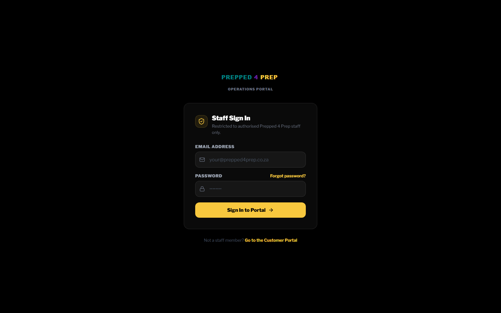
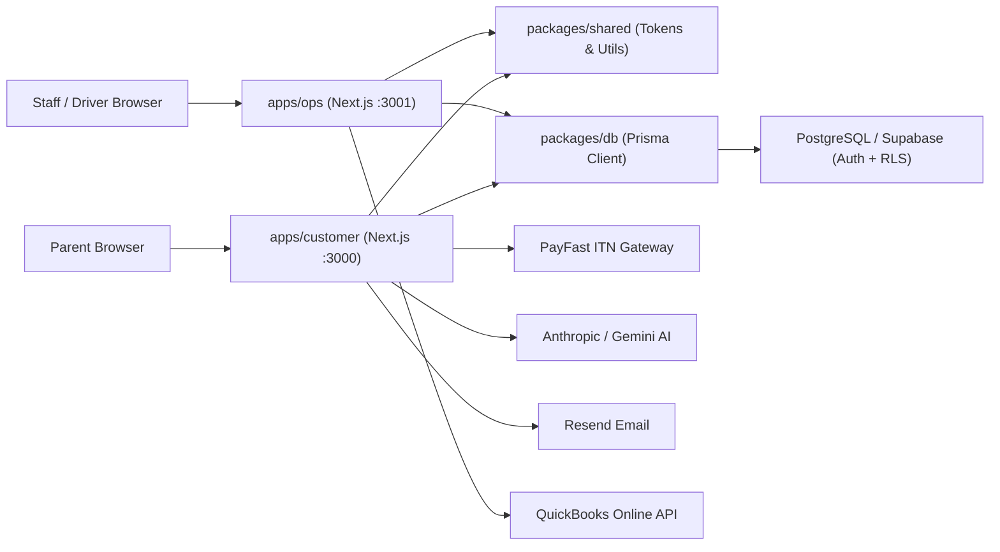

<div align="center">
  
  <h1>Prepped 4 Prep (P4P)</h1>
  <p>
    <strong>Dual-application school stationery e-commerce storefront &amp; warehouse fulfillment monorepo with AI list scanning, PayFast checkout, barcode packing, and QuickBooks sync.</strong>
  </p>

  <p>
    
    
    
    
    
    <a href="LICENSE"></a>
  </p>

  <p>
    <a href="https://p4p-customer.onrender.com">Live Storefront</a> •
    <a href="https://p4p-ops.onrender.com">Operations Portal</a> •
    <a href="#-screenshots">Screenshots</a> •
    <a href="#-features">Features</a> •
    <a href="#%EF%B8%8F-architecture--tech-stack">Architecture</a> •
    <a href="#-getting-started">Getting Started</a>
  </p>
</div>

---

## What Is Prepped 4 Prep?

**Prepped 4 Prep** connects Durban parents with school-verified back-to-school stationery packs while giving warehouse, driver, finance, and admin teams a dedicated internal operations portal.

The `pnpm` monorepo strictly isolates the public **Customer Storefront (`apps/customer`)** from the **Internal Operations Portal (`apps/ops`)** so parent browsers never download staff or accounting code, while both apps share a single **Prisma + PostgreSQL** data layer (`packages/db`) and design system (`packages/shared`) governed by Supabase Auth role claims and Row-Level Security (RLS).

---

## 🌐 Live Deployments

| Application | URL | Role |
| --- | --- | --- |
| **Customer Storefront** | [p4p-customer.onrender.com](https://p4p-customer.onrender.com) | School list picker, AI list scanner, cart, PayFast checkout & order tracking |
| **Operations Portal** | [p4p-ops.onrender.com](https://p4p-ops.onrender.com) | Staff-only packing queue, barcode verification, delivery POD & QuickBooks sync |

---

## 📱 Screenshots

<table>
  <tr>
    <td align="center" width="50%">
      <br />
      <sub><strong>Customer Storefront</strong> — Landing page for Durban school stationery &amp; book covering</sub>
    </td>
    <td align="center" width="50%">
      <br />
      <sub><strong>School &amp; Grade Picker</strong> — Auto-populates exact school list templates into cart</sub>
    </td>
  </tr>
  <tr>
    <td align="center" colspan="2">
      <br />
      <sub><strong>Operations Portal</strong> — Isolated internal sign-in for warehouse, driver, finance &amp; admin staff</sub>
    </td>
  </tr>
</table>

---

## ✨ Features

### Customer Storefront (`apps/customer`)
- **School & Grade Template Picker**: Select a school and grade to populate an editable stationery cart from reusable list templates.
- **AI Smart List Import**: Upload a PDF/photo or paste raw stationery list text; server-side AI extracts line items, maps them to catalog products, suggests cheaper alternatives, and recommends book-covering or custom labeling add-ons.
- **PayFast Checkout & ITN Webhooks**: Sandbox and live South African PayFast integration with signature-verified server ITN callbacks and stock deduction.
- **POPIA Compliance**: Explicit opt-in consent timestamps, AES-256 PII column encryption, Upstash Redis rate limiting, and ephemeral list processing.

### Internal Operations Portal (`apps/ops`)
- **Role-Based Access Control**: Scoped permissions for `Admin`, `Finance`, and `Warehouse` staff via Supabase claims + RLS.
- **Barcode-Verified Packing Queue**: Scan items with `html5-qrcode` / `qrcode` during packing and generate printable box notes.
- **Delivery & Proof of Delivery**: Driver delivery route tracking and digital POD capture.
- **QuickBooks Online Sync**: Automated two-way OAuth2 sync creating QuickBooks invoices for paid orders and tracking sync state.

---

## 🛠️ Architecture & Tech Stack



| Layer | Technology |
| --- | --- |
| **Frameworks** | Next.js 16 (App Router), React 19, TypeScript |
| **Monorepo & Styling** | `pnpm` workspaces, Tailwind CSS v4 |
| **Database & Auth** | PostgreSQL (Supabase), Prisma ORM, Supabase Auth & Row-Level Security |
| **Integrations** | PayFast, Anthropic / Gemini AI, QuickBooks Online OAuth2, Resend, Upstash Redis |
| **Testing & Hosting** | Playwright E2E, Vitest, Render ([`render.yaml`](render.yaml)) |

### Project Structure

```text
P4P/
├── apps/
│   ├── customer/            # Public parent storefront (Next.js App Router, port 3000)
│   └── ops/                 # Isolated staff operations portal (Next.js App Router, port 3001)
├── packages/
│   ├── db/                  # Prisma schema, migrations, seed script & supabase-rls.sql
│   └── shared/              # Brand theme tokens, shared TypeScript types & helpers
├── tests/                   # Playwright & Vitest test suites
├── docs/screenshots/        # UI screenshots used in README
├── .env.customer.example    # Customer portal environment template
├── .env.ops.example         # Operations portal environment template
└── render.yaml              # Dual-service Render deployment configuration
```

---

## 🚀 Getting Started

### Prerequisites
- **Node.js 20+** and **`pnpm`**
- A **PostgreSQL / Supabase** project

### 1. Clone, Install & Configure
```bash
git clone https://github.com/KevinAsanda/P4P.git
cd P4P
pnpm install
cp .env.customer.example apps/customer/.env.local
cp .env.ops.example apps/ops/.env.local
```
> Ensure `ENCRYPTION_SECRET` (32+ characters) matches across both `apps/customer/.env.local` and `apps/ops/.env.local`.

### 2. Prepare Database & Run Locally
```bash
pnpm db:generate
pnpm db:push
pnpm db:seed

# Run apps in separate terminals
pnpm dev:customer   # http://localhost:3000
pnpm dev:ops        # http://localhost:3001
```
*(Apply `packages/db/supabase-rls.sql` in your Supabase SQL Editor for production RLS rules.)*

### 3. Build & Test
```bash
pnpm build
pnpm test:unit
pnpm test
```

---

## 📄 License

Distributed under the **MIT License**. See [`LICENSE`](LICENSE) for details.
